# Projeto MongoDB com Node.js, Express e Thunder Client

## Sobre o projeto

Neste projeto, pratiquei como guardar e consultar informações usando o MongoDB. Para isso, montei uma API simples de produtos com Node.js e, testei as rotas pelo Thunder Client no Visual Studio Code e conferi os resultados no MongoDB.

A ideia é cadastrar produtos, consultar a lista, alterar as informações de um produto e excluir um registro. Os exemplos usados são produtos de uma loja, como notebook, PS4 e celulares.

## 1. O que foi utilizado

- **MongoDB Community Server:** banco de dados que fica rodando no computador.
- **MongoDB Compass:** programa visual para conferir os bancos, as coleções e os documentos.
- **Node.js:** permite executar JavaScript fora do navegador.
- **Express:** ajuda a criar as rotas da API.
- **Thunder Client:** extensão do VS Code usada para enviar requisições e ver as respostas da API.
- **Visual Studio Code:** editor onde ficam os arquivos do projeto.
- **Git e GitHub:** ferramentas para controlar as alterações e guardar o código do projeto em um repositório.

Uma observação importante: o Thunder Client não conversa diretamente com o banco de dados neste exercício. Ele envia uma requisição para a API, que é executada pelo Node.js. A API é quem acessa o MongoDB. Já o GitHub guarda uma cópia do código e do histórico do projeto; ele não é o banco de dados local.

## 2. Instalando o MongoDB no Windows

As imagens que acompanham este README mostram o banco já funcionando no Compass. Por isso, os passos abaixo descrevem o processo de instalação para quem ainda precisa preparar o computador.

1. Acesse o site oficial do MongoDB: https://www.mongodb.com/try/download/community
2. Escolha a versão do **MongoDB Community Server** para Windows e baixe o instalador `.msi`.
3. Abra o arquivo baixado e siga as telas do instalador.
4. Quando aparecer o tipo de instalação, escolha **Complete** para instalar os componentes padrão.
5. Se a opção aparecer, marque a instalação como um serviço do Windows. Assim, o MongoDB pode iniciar como serviço do sistema.
6. Se houver a opção de instalar o **MongoDB Compass**, deixe marcada para ter a ferramenta visual. Caso não apareça, ele pode ser baixado separadamente em https://www.mongodb.com/try/download/compass.
7. Termine a instalação. Se o instalador pedir, permita que ele conclua as configurações.
8. Abra o MongoDB Compass e conecte usando o endereço local:

   ```text
   mongodb://127.0.0.1:27017
   ```

Esse endereço aponta para o MongoDB instalado no próprio computador. A porta padrão do MongoDB é `27017`. Se a conexão falhar, verifique se o serviço do MongoDB está instalado e em execução.

## 3. Entendendo o Compass, o banco e a coleção

No Compass, a conexão local aparece como `localhost:27017`. Dentro dela, o banco utilizado no projeto é `loja`, e a coleção é `produtos`.

- **Banco de dados (`loja`):** reúne os dados do projeto.
- **Coleção (`produtos`):** funciona como um agrupamento de registros relacionados, parecido com uma tabela em outros bancos.
- **Documento:** é cada produto salvo na coleção.
- **`_id`:** identificador único que o MongoDB cria para cada documento, caso nenhum seja informado.

Cada produto tem os campos `nome`, `preco` e `categoria`. Um exemplo de documento é:

```json
{
  "nome": "Notebook gamer",
  "preco": 2300,
  "categoria": "Eletronicos"
}
```

Na primeira captura, a coleção mostra um produto. Na imagem seguinte, já aparecem dois. Mais adiante, as capturas mostram os produtos sendo adicionados, alterados e excluídos durante os testes.

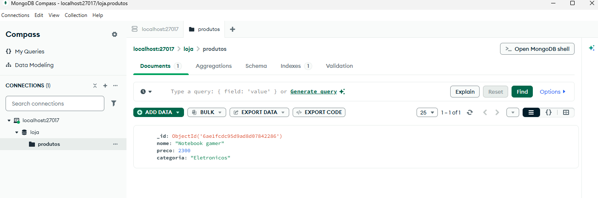

*Figura 1 — A coleção `produtos` aberta no MongoDB Compass, com um documento cadastrado.*

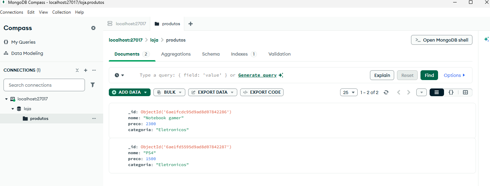

*Figura 2 — A coleção passa a mostrar dois documentos.*

## 4. Preparando o projeto no Visual Studio Code

Antes de testar as rotas, é necessário ter o Node.js instalado. O instalador oficial fica em https://nodejs.org/. Depois de instalar, abra a pasta do projeto no VS Code e use o terminal integrado.

Para iniciar um projeto Node.js, os comandos básicos são:

```bash
npm init -y
npm install express mongodb
```

O primeiro comando cria o arquivo `package.json`, que guarda informações e dependências do projeto. O segundo instala o Express e o driver oficial do MongoDB, que permite que o JavaScript acesse o banco.

O código das capturas utiliza `index.js` como arquivo principal. Nele, são importadas as bibliotecas, configurado o Express, criada a conexão com o MongoDB e definidas as rotas da API.

## 5. Configurando a conexão no arquivo `.env`

Na imagem do arquivo `.env`, a variável aparece assim:

```env
MONGO_URI=mongodb://127.0.0.1:27017
```

Essa variável guarda o endereço usado para conectar ao MongoDB local. O código lê esse valor por meio de `process.env.MONGO_URI`.

Para que isso funcione, o projeto precisa carregar as variáveis do arquivo `.env`. Uma maneira comum é instalar o pacote `dotenv`:

```bash
npm install dotenv
```

E adicionar no começo do `index.js`, antes de usar `process.env.MONGO_URI`:

```js
require('dotenv').config();
```

**Atenção:** esse carregamento com `dotenv` não aparece nas capturas do `index.js`. Ele deve ser adicionado caso o projeto ainda não carregue o `.env` de outra forma. Sem isso, `process.env.MONGO_URI` pode ficar sem valor.

## 6. Protegendo os arquivos com `.gitignore`

A captura do `.gitignore` mostra estas linhas:

```gitignore
.env
node_modules/
```

Isso significa que o Git deve ignorar o arquivo `.env` e a pasta `node_modules/` quando forem adicionados arquivos ao repositório.

- `.env` pode conter endereços e credenciais de conexão, então não deve ser publicado.
- `node_modules/` contém as bibliotecas instaladas pelo npm. Em geral, ela pode ser recriada usando `npm install`.

O `.gitignore` só impede que arquivos ainda não rastreados sejam adicionados automaticamente. Se o `.env` já tiver sido enviado ao GitHub, será necessário removê-lo do controle do Git e, se ele contiver uma senha ou segredo, trocar esse dado.

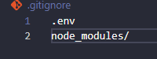

*Figura 3 — O `.gitignore` evita incluir o `.env` e `node_modules` no repositório.*

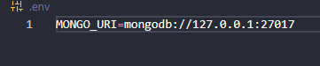

*Figura 4 — A variável `MONGO_URI` aponta para o MongoDB local.*

## 7. Entendendo o arquivo `index.js`

O código mostrado na imagem usa `express` e `mongodb`. A ideia geral é:

1. Importar as bibliotecas.
2. Criar a aplicação Express.
3. Habilitar a leitura de requisições em JSON com `express.json()`.
4. Criar o cliente do MongoDB com `MongoClient`.
5. Selecionar o banco `loja` e a coleção `produtos`.
6. Criar as rotas GET, POST, PUT e DELETE.
7. Conectar ao banco e iniciar a API na porta `3000`.

A imagem mostra esta parte da conexão:

```js
const client = new MongoClient(process.env.MONGO_URI);
const produtos = client.db('loja').collection('produtos');
```

A primeira linha prepara o cliente de conexão. A segunda seleciona o banco `loja` e a coleção `produtos`.

No final, o código chama `client.connect()` e inicia a API com `app.listen(3000, ...)`. Assim, o Thunder Client pode enviar requisições para endereços como `http://localhost:3000/produtos`.

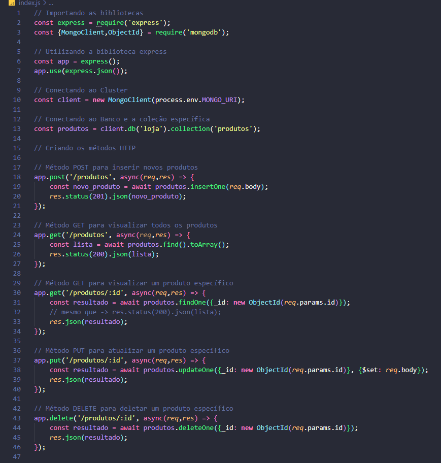

*Figura 5 — O arquivo `index.js` contém as rotas que manipulam os produtos.*

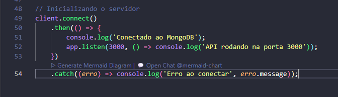

*Figura 6 — A conexão com o banco é iniciada e a API passa a escutar na porta 3000.*

## 8. Testando a API pelo Thunder Client

Com o MongoDB em execução e a API iniciada, abra o Thunder Client no VS Code. Em cada teste, selecione o método HTTP, informe a URL, preencha o corpo quando necessário e clique em **Send**.

Neste projeto, as rotas mostradas no código são:

| Método | Endereço | Para que serve |
|---|---|---|
| GET | `http://localhost:3000/produtos` | Consultar todos os produtos |
| GET | `http://localhost:3000/produtos/ID_DO_PRODUTO` | Consultar um produto pelo identificador |
| POST | `http://localhost:3000/produtos` | Cadastrar um produto |
| PUT | `http://localhost:3000/produtos/ID_DO_PRODUTO` | Atualizar um produto específico |
| DELETE | `http://localhost:3000/produtos/ID_DO_PRODUTO` | Excluir um produto específico |

Troque `ID_DO_PRODUTO` pelo valor real de `_id` de um documento. O identificador deve ser copiado do Compass ou da resposta da API.

### 8.1 POST — cadastrar um produto

O método **POST** é usado para criar um registro. Na captura, o endereço é `localhost:3000/produtos`, o método selecionado é POST e o Thunder Client retorna o status `201 Created`.

No campo **Body**, selecione JSON e envie um documento como este:

```json
{
  "nome": "Iphone 17 pro max",
  "preco": 7000,
  "categoria": "Eletronicos"
}
```

Quando a API recebe a requisição, `req.body` contém os dados enviados. O código usa `insertOne()` para gravar o documento na coleção. A resposta mostra o resultado da inserção e o identificador criado pelo MongoDB.

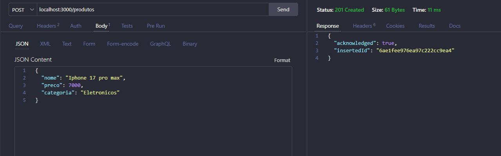

*Figura 7 — O POST cadastra o produto e retorna `201 Created`.*

Depois do envio, o novo documento aparece no Compass. Nas capturas, a coleção passa a mostrar mais produtos.

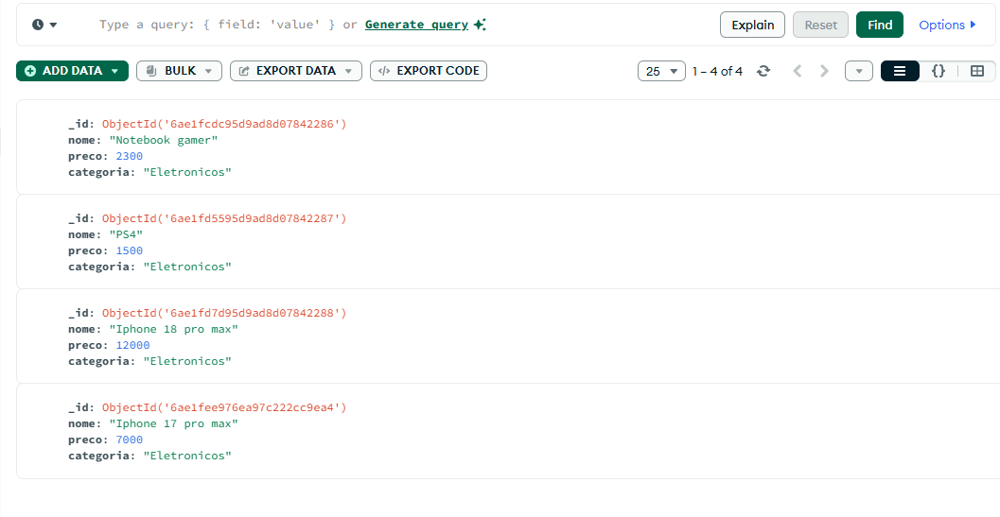

*Figura 8 — O Compass permite confirmar os documentos salvos na coleção.*

### 8.2 GET — consultar os produtos

O método **GET** serve para buscar informações. A rota `GET /produtos` utiliza `find().toArray()` para consultar os documentos da coleção e retornar a lista em JSON.

Para testar, selecione GET, informe:

```text
http://localhost:3000/produtos
```

e clique em **Send**. Para consultar um único produto, use o identificador na rota `GET /produtos/:id`.

A captura do código confirma que essas duas rotas GET foram criadas. As imagens do Compass também ajudam a verificar quais documentos estão cadastrados.

### 8.3 PUT — atualizar um produto

O método **PUT** é usado neste projeto para atualizar os dados de um produto que já existe. Na captura, foi enviado um corpo JSON com um nome, preço e categoria diferentes. A resposta mostra `matchedCount: 1` e `modifiedCount: 1`, o que indica que um documento foi encontrado e alterado.

O endereço deve incluir o ID do produto:

```text
http://localhost:3000/produtos/ID_DO_PRODUTO
```

Exemplo de corpo JSON usado para atualizar os dados:

```json
{
  "nome": "Iphone 16 pro max",
  "preco": 6000,
  "categoria": "Eletronicos"
}
```

No código da captura, a atualização é feita com `updateOne()` e `$set`, que altera os campos enviados no documento encontrado pelo `_id`.

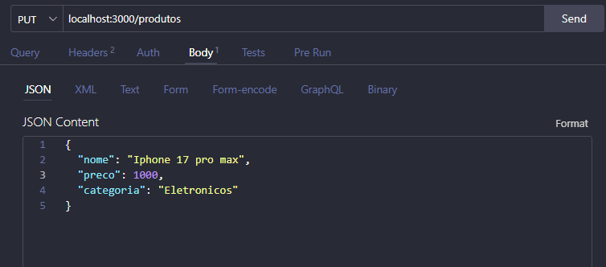

*Figura 9 — O corpo JSON contém os novos dados do produto.*

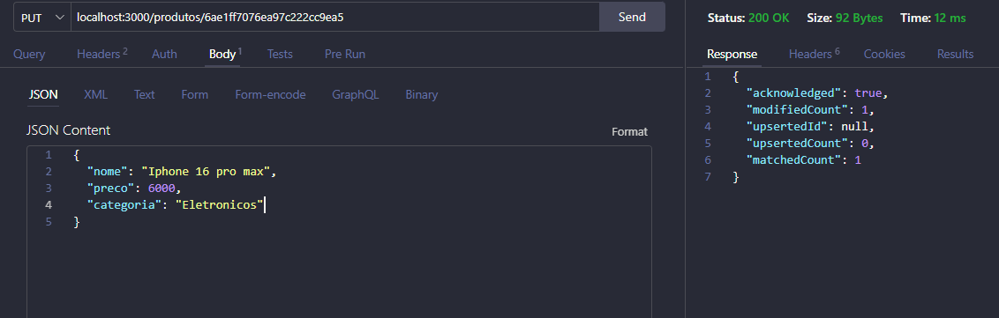

*Figura 10 — A resposta confirma que um documento foi encontrado e modificado.*

Após o teste, o Compass mostra o produto atualizado. É uma forma visual de conferir se a alteração realmente foi salva no banco.

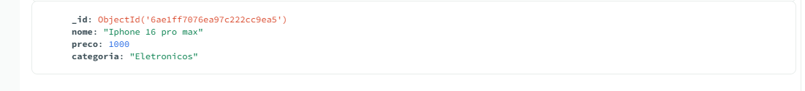

*Figura 11 — O produto aparece com os dados atualizados.*

### 8.4 DELETE — excluir um produto

O método **DELETE** serve para excluir um registro. Na captura, o endereço inclui o ID do produto e a resposta apresenta `deletedCount: 1`, indicando que um documento foi removido.

O formato da rota é:

```text
http://localhost:3000/produtos/ID_DO_PRODUTO
```

Antes de enviar o DELETE, confira o ID com cuidado: a exclusão remove o documento correspondente. O código da API usa `deleteOne()` para apagar somente o produto que corresponde ao identificador informado.

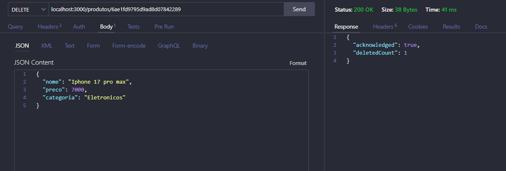

*Figura 12 — O DELETE remove um produto e retorna `deletedCount: 1`.*

## 9. Conferindo o resultado no MongoDB Compass

Depois de usar POST, PUT e DELETE, o Compass ajuda a conferir os resultados diretamente na coleção:

- Depois do POST, aparece um novo documento.
- Depois do PUT, os campos do documento escolhido apresentam os valores atualizados.
- Depois do DELETE, o documento excluído deixa de aparecer.
- O GET permite consultar os dados sem alterar a coleção.

As capturas mostram diferentes momentos da atividade. Por isso, a quantidade de documentos muda de uma imagem para outra: elas registram etapas diferentes dos testes, e não necessariamente o estado final ao mesmo tempo.

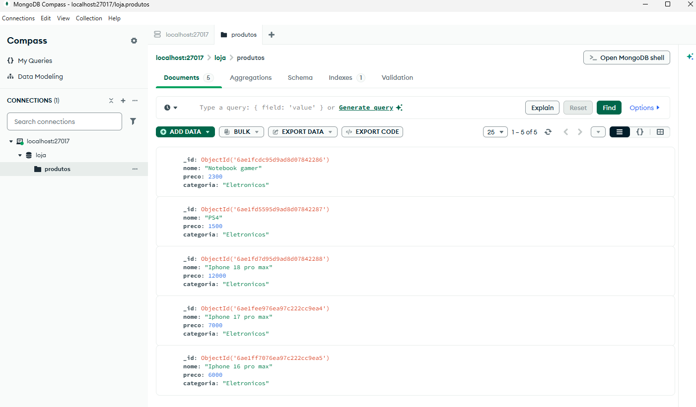

*Figura 13 — A coleção mostra os produtos cadastrados naquele momento dos testes.*

## 10. Enviando o projeto para o GitHub

O GitHub é usado para guardar e compartilhar os arquivos do projeto. Ele não faz a conexão local com o MongoDB automaticamente: para executar a API em outro computador, será necessário instalar as dependências, configurar o ambiente e ter um MongoDB acessível.

1. Entre em https://github.com/ e crie um repositório.
2. Abra a pasta do projeto no VS Code.
3. Confira se o `.gitignore` está configurado para ignorar `.env` e `node_modules/`.
4. Abra o terminal integrado e execute os comandos abaixo, se o Git ainda não estiver inicializado:

   ```bash
   git init
   git add .
   git commit -m "Projeto inicial com MongoDB"
   ```

5. No GitHub, copie o endereço do repositório criado. Depois, conecte a pasta local ao repositório remoto:

   ```bash
   git remote add origin URL_DO_SEU_REPOSITORIO
   git branch -M main
   git push -u origin main
   ```

   Substitua `URL_DO_SEU_REPOSITORIO` pelo endereço real do seu repositório.

Se o repositório já estiver conectado, não é necessário repetir `git remote add origin`. Depois de novas alterações, normalmente basta usar `git add .`, `git commit -m "Descrição da alteração"` e `git push`.

**Importante:** não envie o arquivo `.env` ao GitHub. Se o projeto usar somente a conexão local `127.0.0.1`, essa configuração funcionará apenas no computador em que o MongoDB estiver instalado e rodando. Para executar em outro ambiente, será preciso configurar uma URI válida para esse ambiente.

## 11. Problemas comuns

- **O Compass não conecta:** confira se o MongoDB está instalado e em execução e se a URI está correta.
- **O Thunder Client não responde:** confirme se a API está rodando no terminal e se a URL usa a porta `3000`.
- **A API não encontra o MongoDB:** confira a variável `MONGO_URI` e se o arquivo `.env` está sendo carregado.
- **O POST não lê o JSON:** verifique se `app.use(express.json())` aparece antes das rotas.
- **O GET, PUT ou DELETE por ID falha:** confira se o ID foi copiado corretamente e se é um `ObjectId` válido.
- **O GitHub tenta enviar `node_modules`:** confira se o `.gitignore` está na raiz correta do projeto. Se a pasta já estiver sendo rastreada pelo Git, será necessário removê-la do rastreamento.

## Conclusão

Com essa atividade, pratiquei como configurar um banco MongoDB local, organizar os dados em uma coleção, criar uma API com Node.js e Express e testar as operações pelo Thunder Client. Também conferi os resultados no Compass e preparei o projeto para ser guardado no GitHub, mantendo arquivos locais de configuração fora do repositório.

Esse exercício ajudou a entender como as partes trabalham juntas: o Thunder Client envia as requisições, a API processa os pedidos e acessa o MongoDB, o Compass permite visualizar os dados e o GitHub guarda o código do projeto.
